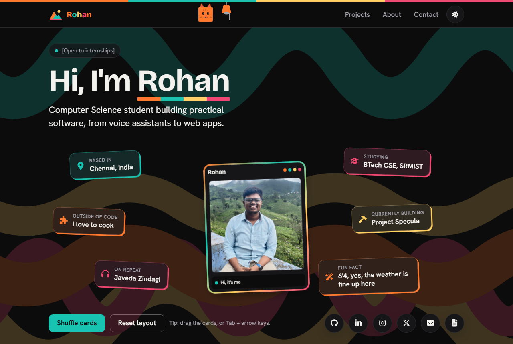

# Rohan's portfolio

Personal portfolio of Rohan, a Computer Science student building practical software, from voice assistants to web apps.

A playful, matte-black "sticker collage" site: draggable fact cards around a holographic photo card, colour ribbons drifting across the background, a 3D cat in the top bar and a few hidden easter eggs. Behind it sits a small, secure backend for the contact form and privacy-friendly analytics.



## Highlights

- **Sticker collage hero.** Six fact cards you can drag, fling, shuffle and reset (also with the keyboard: Tab, then the arrow keys), scattered around the photo card.
- **Holographic photo card.** Tilts toward the mouse in 3D with a rainbow foil sheen; press the photo for a new caption.
- **Hand-rolled 3D, no 3D library.** The card, the cat and the tilting tiles are plain CSS 3D transforms, so they cost almost nothing to download.
- **Two themes.** Matte black by default, with a light theme. Switch with the sun/moon button or by pulling the lamp cord in the top bar.
- **Easter eggs.** Hidden in the top bar (spoilers below).
- **Contact form** backed by a serverless API with validation, rate limiting and spam protection.
- **Privacy-friendly analytics.** No cookies, no third parties, no stored IP addresses.
- **Accessible and fast.** Keyboard and screen-reader friendly, respects "reduce motion", WCAG AA contrast in both themes. Lighthouse (measured locally): Performance 97-98, Accessibility 100, Best Practices 100, SEO 100.

<details>
<summary>Easter egg spoilers</summary>

- Pet the cat in the top bar 7 times in quick succession and it falls asleep. Click it again to wake it.
- Pull the lamp cord 5 times within 2.5 seconds for disco mode: coloured stage lights sweep in from the corners and confetti pops across the page.

</details>

## Tech stack

| Part | Built with |
| ---- | ---------- |
| Frontend | [Vite](https://vite.dev), [React](https://react.dev), TypeScript, [Tailwind CSS v4](https://tailwindcss.com), [Framer Motion](https://motion.dev), [react-icons](https://react-icons.github.io/react-icons/) |
| Backend | [Vercel](https://vercel.com) serverless functions (Node, TypeScript), [zod](https://zod.dev) for validation |
| Database | [Supabase](https://supabase.com) (Postgres with Row Level Security) |
| Tests | [Vitest](https://vitest.dev) |
| Hosting | Vercel (site and API deploy together as one project) |

## Getting started

Requires Node 20 or newer.

```bash
git clone https://github.com/Rohan-270607/website.git
cd website
npm install
npm run dev        # the site on http://localhost:5173
```

| Command | What it does |
| ------- | ------------ |
| `npm run dev` | Site only, with hot reload. There is no `/api` here, so the contact form shows its "email me instead" fallback. |
| `npm run dev:full` | Site and `/api` together via `vercel dev` (needs the Vercel CLI login and a `.env`, see [`docs/BACKEND.md`](docs/BACKEND.md)). |
| `npm run build` | Type-checks, then builds the site to `dist/`. |
| `npm run preview` | Serves the production build on http://localhost:4173. |
| `npm test` | Backend tests (they use a fake database, so no network or setup is needed). |

## Project structure

```
src/
  content/profile.ts          all text and links (name, facts, projects, socials, SEO)
  styles/tokens.css           colour palette (dark + light), fonts, type scale
  styles/index.css            shared styles: cards, buttons, stripe, 3D, waves, disco lights
  components/
    Nav, ThemeToggle          sticky top bar (highlights the section on screen), theme switch
    Logo, logoShape.ts        the mountain mark and its geometry and colours
    ColorWord                 the name with letters in the four brand colours
    CatMascot                 3D cat head in the top bar (easter egg)
    LampCord, Disco           lamp whose cord switches the theme; disco mode (easter egg)
    Hero                      status pill, headline, photo card, fact cards, social links
    HoloCard                  the holographic photo card
    FloatingStickers          the draggable fact cards with Shuffle / Reset and keyboard moves
    SocialDock                round social buttons (hero and footer)
    Waves                     colour ribbons sweeping across the background
    ProjectTiles, DemoPlayer  project tiles with Live / Code links and click-to-play demo clips
    AboutScatter              About notes on a dotted grid
    ContactForm               contact form (posts to /api/contact, falls back to email)
    Footer                    sign-off, copy-email button, back to top
    CursorTrail               four-dot comet that follows the mouse; a cat cursor over buttons
    SectionHeading, Reveal, Tilt   shared building blocks
  App.tsx                     puts the sections together
  track.ts                    tiny analytics helper (sends events to /api/track)
  theme.ts                    reads and switches dark/light
  useTilt.ts                  pointer-to-3D-angle hook used by Tilt
api/                          the backend: one file per endpoint (contact, track, resume, health)
  _lib/                       shared helpers: env, Supabase client, validation, rate limit, hashing, email
  _types/                     database row types and API request/response types
  _tests/                     Vitest tests for every endpoint, plus a security scan
supabase/
  migrations/                 database schema, Row Level Security, storage bucket
  tests/rls.sql               proves the security rules (run in the Supabase SQL editor)
public/                       photo, resume, favicon, link-preview image
scripts/make-images.ps1       regenerates the link-preview image and home-screen icon
docs/                         BACKEND.md (setup), API.md (contract), DECISIONS.md (why)
```

Files and folders in `api/` that start with `_` are helpers, not endpoints (a Vercel convention).

## Editing content

Almost everything you read on the site lives in **`src/content/profile.ts`**: name, intro, status pill, the six facts, photo captions, social links, projects, About notes, sign-off and the SEO title and description. Text still in `[square brackets]` is a placeholder.

- **Photo:** `public/me.jpg`, a square crop around the head and shoulders (about 800x800 px). Update `photo.width` / `photo.height` if the size changes. A transparent PNG cutout also works: point `photo.src` at it and set `photo.cutout: true`.
- **Resume:** replace `public/resume.pdf`.
- **Project demo clips** (about 10 seconds): put the file in `public/demos/` and set the project's `demo` in `profile.ts` (`src` for the clip, `poster` for a still shown before it plays, `alt` describing it). `.mp4` or `.webm` look the same as a GIF at about a tenth of the size. Clips load only when Play is pressed.
- **Colours:** the palette is at the top of `src/styles/tokens.css`. Cards, tiles and buttons each pick one of `orange | teal | gold | rose`.
- **Link previews:** `public/og.png` is the card shown when the link is shared. Regenerate it with `powershell -ExecutionPolicy Bypass -File scripts/make-images.ps1 -OutDir public -Title "Rohan" -Subtitle "Computer Science student"`. It needs `siteUrl` in `profile.ts` to be the live URL.

The page title, description, social-preview tags and search-engine data (a schema.org `Person` with the social links) are written into the HTML at build time from `profile.ts` (see `vite.config.ts`), so crawlers see them without running JavaScript.

### Adding a section

1. Create a component like `src/components/Skills.tsx` returning `<section id="skills" aria-labelledby="skills-heading" className="page ...">`, starting with `<SectionHeading>` (give it the next number). `ProjectTiles.tsx` is a good template.
2. Put its text in `profile.ts`, not in the JSX.
3. Render it in `App.tsx` in page order, imported with `lazy()` like the other sections below the hero.
4. Add its link to the `nav` array in `profile.ts`.

## How it works

**Look.** Matte black (`#0c0c0d`) with four colours (orange, teal, gold, rose) used for card edges, hard offset shadows, icons and a stripe motif. Dark is the default on purpose. The light theme uses the same four hues, deepened for contrast. The choice is saved in `localStorage` and applied by a tiny script in `index.html` before the first paint, so there is no flash of the wrong theme.

**Background waves.** Five thick ribbons, random on every load, slide across the screen. Each is one SVG path moved only with the CSS `translate` property, which the browser animates on the graphics card without repainting. Their colours are mixed into the background so text on top keeps its contrast.

**3D.** Plain CSS 3D transforms (`perspective`, `preserve-3d`, `translateZ`):
- the photo card, whose name and caption strips sit in front of the photo and shift against it as it tilts;
- the cat head, a real six-sided box with ears that turns to follow the mouse;
- the project tiles and About notes, which tilt toward the pointer with a soft glare.

**Motion and accessibility.** Pointer effects (tilt, cursor trail, cat head) run only with a real mouse, never on touch screens. With "reduce motion" switched on, pop-ins, drifting waves, the card float and disco mode are all turned off, and everything is simply there. The draggable cards can also be moved with the keyboard. The easter eggs announce themselves to screen readers too.

**Performance.** The sections below the hero load as separate chunks after the first paint. The drag features of Framer Motion load later still. The photo is preloaded. The confetti is drawn on a single canvas instead of hundreds of DOM elements.

## Backend

The site uses it for two things:

- **Contact form** (`src/components/ContactForm.tsx` -> `POST /api/contact`). The message is validated, rate-limited (5 per hour per visitor), checked against a hidden honeypot field for bots and stored in the `messages` table. With [Resend](https://resend.com) set up, it is also emailed on. If anything fails, the visitor is shown the email address instead, so no message is lost.
- **Analytics** (`src/track.ts` -> `POST /api/track`). Counts page views, project link clicks and resume downloads. No cookies, no third parties, and no raw IP addresses are stored (only a salted hash that changes daily). It is off on localhost and for visitors with Do Not Track on; set `analytics: false` in `profile.ts` to switch it off.

There is also `GET /api/health` for an uptime monitor, and `GET /api/resume`, which can serve the resume from Supabase Storage and count downloads (the site currently links to `public/resume.pdf` directly).

Messages and stats can be read in the Supabase dashboard (Table Editor -> `messages`, `events`).

**Security.**
- **Row Level Security:** every table has it switched on, with table permissions locked down as well.
- **Private tables:** the `messages`, `events` and `rate_limits` tables can only be written by the API.
- **No keys in the browser:** it only talks to `/api` on the same domain.
- **Server-side secrets:** they live in Vercel's environment variables. `.env` is git-ignored, and `.env.example` lists the names.
- **Automated check:** `api/_tests/security.test.ts` fails if the secret key is ever referenced outside the two files that need it.

The full setup, the API contract and the reasoning behind the design are in [`docs/BACKEND.md`](docs/BACKEND.md), [`docs/API.md`](docs/API.md) and [`docs/DECISIONS.md`](docs/DECISIONS.md).

## Deploying to Vercel

1. Create a Supabase project and run the SQL in `supabase/migrations/` (steps 1-4 of [`docs/BACKEND.md`](docs/BACKEND.md)).
2. In the Vercel dashboard: **Add New -> Project**, then import this repository. The framework preset **Vite** is detected automatically (build `npm run build`, output `dist`), and the functions in `api/` are picked up on their own.
3. **Settings -> Environment Variables:** add `SUPABASE_URL`, `SUPABASE_SERVICE_ROLE_KEY`, `IP_HASH_SALT` and `ALLOWED_ORIGINS` (the live URL, e.g. `https://your-site.vercel.app`, plus any custom domain). Optionally add `RESEND_API_KEY` and `NOTIFY_TO_EMAIL` to receive each message by email.
4. Deploy. Then set `siteUrl` in `src/content/profile.ts` to the live URL (link previews need it) and push again.
5. Check that `https://your-site/api/health` reports `"db": "ok"`, and send a test message through the form.
